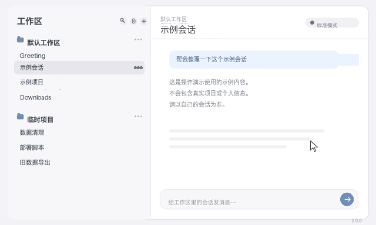

# 工作区管家（dsh-workspace-curator）

一个用于 **DeepSeek Harness（DSH）** 的工作区 / 会话管理插件：在会话和工作区的 `…` / 右键菜单里直接删除，也可以在设置页里集中管理。

## 操作演示



> 上图为操作示意：① 会话行 `…` →「删除会话」；② 工作区行 `…` →「删除工作区」。实际界面以当前 DSH 版本为准。
>
> 动画中的会话、项目名称与路径均为虚构示例。

## 2.0.3 显示修复

排队删除后不再调用会话列表 `sessions.refresh()`。之前这一步会把刚归档的会话重新拉回列表，看起来像“删除后变成归档”。现在只依赖 Host 的 `api-session/removed` 事件移除行；磁盘日志仍然在重启 DSH 后清理。

## 2.0.2 稳定版：删除逻辑重做

2.0.1 曾尝试在归档后直接删除 live 会话日志。这会导致 DSH 的 live Agent 在日志被移除后重新写入一个没有工作区归属的会话，表现为会话跑到「未分组」。2.0.2 恢复并固化安全不变量：

- **冷会话**：直接删除日志、子代理日志和工作区/归档/置顶引用。
- **live 会话**：先归档并停止活动，但**不删除日志、不解除工作区归属**；立即从客户端列表移除，id 写入待删除队列，**重启 DSH 时**删除日志和引用。
- **活动中的会话**：先停止活动；live 仍走上面的重启队列。
- **工作区删除**：冷会话直接删；live 会话只排队，工作区文件夹和注册仍按确认删除。

为什么不能直接删 live 日志：DSH 的 Agent 所有权在创建者（loop）手里，插件拿到的只是 bare Agent，没有安全 dispose 能力。强行删除 live 日志会造成“未分组复活”，所以重启后清理是唯一稳定方案。

## 2.0.0 更新内容

### 新增

- **会话菜单删除**：会话行右侧 `…` 或右键 →「删除会话」，不需要再进设置页；不注册快捷键。
- **工作区菜单删除**：工作区行右侧 `…` 或右键 →「删除工作区」。
- **工作区级联删除**：确认后删除该工作区的**全部会话**、**工作区文件夹**和**工作区注册**，不保留文件夹。
- **单一删除项**：隐藏 DSH 原生的「删除工作区」项，并对真实菜单做启动自检；如果 DSH 升级导致隐藏失效，插件会自动撤下自己的删除项，菜单中**最多只有一个**删除工作区入口，不会出现两个。
- **打开中的会话**：不再拒绝删除。先归档并停止工作，立即从列表移除；日志和引用在**下次启动 DSH** 时清理。
- **最后一个工作区保护**：只剩一个工作区时无法删除，弹窗会禁用「确认删除」，Host 也会拒绝请求；请先添加另一个工作区。
- **避免空白「新会话」**：删除当前会话所在的工作区前，会先切换到另一个可用会话，避免 DSH 因选中项消失而露出或新建空白会话。
- **更明确的工作区确认框**：
  - 标题：删除工作区
  - 文案：将把「XXX」从工作区列表中删除，工作区下的会话将会被删除。
  - 显示会话数量、文件夹路径
  - 红色警告：工作区文件夹及其中的所有文件也会被永久删除，无法恢复。
  - 按钮：取消 / 确认删除
- **提示更准确**：打开中的会话会计入删除总数，并提示「其中 M 个将在重启后清理」。
- **安全与可靠性**：
  - 受保护路径拒绝删除：当前工作目录、home、文件系统根目录、`~/.dsh`、profile、DSH 安装目录、符号链接变化等。
  - 待删除队列原子写入；写入失败可重试，不会留下“假排队”状态。
  - 会话 / 工作区部分引用清理失败时会显示警告。
- **设置页保留**：**设置 → 工作区管家** 仍可添加、重命名、排序工作区、查看会话总览，并使用同一套删除确认。

### 行为变化（相比 1.0.0）

- 移除了“打开中的会话不能删除，请改用归档”的红色拒绝提示。
- 工作区删除从“只移除注册、保留文件和会话”改为“删除全部会话 + 删除文件夹 + 移除注册”。
- 工作区确认框不再使用复选框，改为明确的红色文件夹警告 +「取消 / 确认删除」。
- 工作区删除菜单不绑定快捷键。
- 只有一个工作区时不能删除。

## 使用说明

### 删除单个会话

1. 在左侧找到要删除的会话。
2. 点击行尾的 `…`，或右键打开菜单。
3. 选择「删除会话」。
4. 在确认框里点击「删除」。

结果：

- 没有打开、没有运行中工作的会话：日志、子代理会话、归档 / 置顶引用立即删除。
- 正在打开或运行的会话：先归档并停止工作，立即从列表隐藏；日志在下次启动 DSH 后清理。

### 删除工作区

1. 在工作区标题行点击 `…`，或右键打开菜单。
2. 选择「删除工作区」。
3. 确认框会显示：
   - 该工作区下的会话数量；
   - 工作区文件夹路径；
   - 文件夹及其中所有文件会被永久删除的警告。
4. 点击「确认删除」。

确认后会：

1. 删除或排队该工作区的全部会话；
2. 递归删除工作区文件夹；
3. 移除工作区注册。

> ⚠️ 文件夹删除不可恢复，且文件夹里可能包含与 DSH 无关的文件。请先用一次性目录测试。
>
> 如果这是唯一的工作区，弹窗会提示先添加另一个工作区，无法直接删除。
>
> 正在打开中的会话会立即从列表隐藏，但磁盘日志需要重启 DSH 后清理。

### 设置页

打开 **设置 → 工作区管家**：

- 添加、重命名、排序工作区；
- 查看每个工作区的会话；
- 对会话或工作区执行同样的删除流程。

## 安装

从插件市场安装，或执行：

```sh
dsh plugin --profile web add dsh-workspace-curator@2.0.3
```

桌面端可以在 **设置 → 插件** 中安装。请把 `web` 换成你实际运行的 profile 名称。

要求 DSH `0.2.2-rc.5` 或更新版本。

## 删除行为与限制

DSH 的会话持久化接口没有删除动作，因此本插件直接移除会话日志目录。

- **冷会话**：日志、子代理后代、工作区引用、归档记录、置顶记录立即移除。
- **打开中的会话**：归档并停止工作；id 写入持久化待删除队列，下次 Host 启动时删除日志。
- **工作区**：所有会话删除或排队后，删除文件夹，再移除注册。
- **附件和投影缓存**：只删除会话日志和选中的工作区文件夹；位于其他位置的附件、缓存可能继续占用磁盘。
- **受保护路径**：不会删除当前工作目录、home、根目录、`~/.dsh`、profile、DSH 安装目录；路径变成符号链接或解析到别处时也会拒绝。
- **单一删除入口**：如果 DSH 升级后原生工作区删除项无法隐藏，插件会撤下自己的菜单项，只保留原生项；此时级联删除仍可在设置页使用。
- **待删除队列**：写入采用临时文件 + 原子替换；重启清理失败时会保留记录，下次继续尝试。

## 从 1.0.0 升级

2.0.0 的菜单和删除行为变化较大：

- 会话删除从设置页搬到会话行菜单；
- 删除打开中的会话不再被拒绝；会立即隐藏，重启后清理日志；
- 工作区删除现在会删除文件夹和全部会话；
- 最后一个工作区不能删除；
- 不注册任何键盘快捷键。

升级后建议先在一个一次性工作区 / 测试会话上验证菜单和确认框。

## 开发

```sh
npm test
```

- `index.js` — Host 路由。
- `session-delete.js` — 单个会话的删除树、存储格式校验。
- `pending-deletions.js` — 打开中会话的持久化待删除队列。
- `workspace-delete.js` — 工作区级联、文件夹删除、路径保护。
- `client.js` — 设置页、菜单贡献、确认弹窗、重复菜单自检。

## License

MIT
